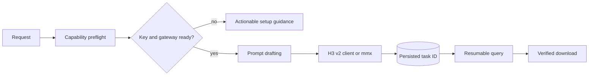

# MiniMax Design

## Plugin marketplaces

This plugin belongs to **AIGC content creation**.

| Category | Marketplace | Purpose |
| --- | --- | --- |
| Full-stack development | [Full Stack Plugins](https://github.com/partme-ai/full-stack-plugins) | Architecture and UI design, code understanding, quality checks, code review, workflow governance, and server operations |
| AIGC content creation | [Full AIGC Plugins](https://github.com/partme-ai/full-aigc-plugins) | Image, video, audio, music, 3D, and multimodal content creation |


> Generate MiniMax H3 video, music, speech, and images from your coding agent: environment-variable auth, first/last-frame anchoring, and resumable paid tasks that are never submitted twice.

[](https://github.com/full-aigc-plugins/minimax-design-plugin/releases)
[](#installation)
[](#skills)
[](LICENSE)

[English](README.md) | [简体中文](README.zh-CN.md) · [Install](#installation) · [Quick start](#quick-start) · [Skills](#skills) · [Troubleshooting](#troubleshooting)

## Positioning

`minimax-design` runs MiniMax generation from a coding agent. It turns a request into H3 video (`t2v`, `i2v`, first/last-frame `FL2VA`, reference-image), music, speech, images, or text through a deterministic Python client or the vendored `mmx` toolkit, and it treats a paid async task as a durable record rather than a fire-and-forget call.

The default creative path is white-model previs anchoring: render first and last frames of each shot in Blender, then let H3 interpolate the motion between them. Prompts are drafted with the vendored `h3-prompt-writing` structures.

| Property | Value |
| --- | --- |
| Plugin ID | `minimax-design` |
| Version | `0.5.1+codex.20261018` |
| Maturity | Packaged release; no live provider acceptance record is stored in this repository |
| Runtime | Python 3 (standard library only); `mmx` CLI optional |
| MCP server | None; the executable client is `scripts/minimax_video.py` |

## Installation

### Prerequisites

- Python 3 on `PATH` for `scripts/minimax_video.py`.
- A MiniMax API key from [platform.minimax.cn](https://platform.minimax.cn) (China) or [platform.minimax.io](https://platform.minimax.io) (international). The gateway region must match the key.
- Optional: the `mmx` CLI for toolkit generation, installed with `npm install -g mmx-cli` and signed in through `mmx auth login --api-key`.
- Optional: Blender white-model previs frames from the companion `blender-previs` skill when you want FL2VA anchoring.

### From the plugin marketplace

```bash
codex plugin marketplace add partme-ai/full-aigc-plugins
codex plugin add minimax-design@full-aigc-plugins
```

### From the repository-local marketplace

```bash
codex plugin marketplace add full-aigc-plugins/minimax-design-plugin --ref v0.5.1
codex plugin add minimax-design@partme-ai-minimax-design
```

Restart the host and open a new task. ZCode loads the plugin through `.zcode-plugin/plugin.json` and auto-discovers `hooks/hooks.json` once; Kimi loads `kimi.plugin.json` with its declared hooks.

### Configure the key

The client resolves the key in this order: process environment, project `.env`, plugin `.env`, then the user credential file. Persist it without editing your shell with:

```bash
python3 scripts/minimax_video.py auth --api-key sk-...
python3 scripts/minimax_video.py check
```

`auth` writes `~/.minimax-design/credentials.json` with mode `600` (override the directory with `MINIMAX_CONFIG_DIR`). `check` reports the key source, gateway, model, and `mmx` status; it prints only the last four characters and never the full key.

## Quick start

```bash
# Capability preflight: auth chain, gateway, model, mmx status
python3 scripts/minimax_video.py check

# Text to video; a ratio is mandatory for T2VA
python3 scripts/minimax_video.py generate --prompt "..." --ratio 16:9 --out shot-01.mp4

# First/last-frame FL2VA anchored by white-model previs frames
python3 scripts/minimax_video.py generate --first-frame first.png --last-frame last.png \
  --prompt "continuous motion between the two frames" --out shot-01.mp4

# A polling timeout is not a failure: resume the same paid task
python3 scripts/minimax_video.py query --task-id <task-id>
```

`generate` takes `--duration` and `--resolution`. Model limits: `MiniMax-H3` supports 480P/768P/2K and 4–15s; `MiniMax-H3-Max` supports 480P/768P and 5–15s. `list` and `cancel` operate on existing tasks, and the client never resubmits a paid task automatically.

## What you can build

| Workflow | Built-in path | Verifiable output |
| --- | --- | --- |
| Text-to-video | `minimax-video-generation`, `generate --ratio` | Downloaded MP4 plus a durable task ID |
| Image-to-video | `generate --first-frame` | MP4 anchored on the supplied first frame |
| First/last-frame shot | `generate --first-frame --last-frame` | MP4 interpolated between two previs frames |
| Reference-consistent subject | `generate --reference-image` | MP4 carrying the reference identity |
| Styled short from a brief | One of the eight style-generator skills | Shot plan, prompts, generated clips, assembly guidance |
| Music, speech, images | `mmx` toolkit or `minimax-music-gen` | Audio, image, or text artifacts in the chosen output directory |

## Skills

| Skill | Purpose |
| --- | --- |
| `minimax-design-use` | Runs the capability preflight first, then routes the request |
| `minimax-video-generation` | H3 v2 workflows: `t2v`, `i2v`, `FL2VA`, reference-image |
| `minimax-multimodal-toolkit` | `mmx` text, image, video, speech, music, and search |
| `minimax-music-gen` | Songs, instrumentals, and background music |
| `minimax-music-playlist` | Taste profiling and generated playlists |
| `h3-prompt-writing` | T2VA, I2VA, FL2VA, L2VA, and Ref2VA prompt structures |
| `3d-animation-short-generator` | End-to-end stylized 3D animated short |
| `brand-promo-video-generator` | Brand and product promotional short |
| `co-op-game-intro-generator` | Two-player co-op menu or opening animation |
| `handdrawn-live-video-generator` | 15-second hand-drawn animation blended with live action |
| `minimalist-product-ad-generator` | Minimalist e-commerce product ad |
| `music-video-subtitle-generator` | Lyric typography and music-video shot plan |
| `paper-collage-explainer-generator` | Halftone paper-collage explainer |
| `papercraft-stop-motion-explainer` | Layered papercraft stop-motion explainer |

`minimax-design-use` and `minimax-video-generation` are plugin-local. The other twelve are vendored verbatim from `minimax-skills v1.1.1` and pinned per skill by SHA-256 in `skills.lock.json`; edit neither copy in place.

## Slash commands

| Command | What it does |
| --- | --- |
| `/minimax-check` | Preflight auth chain, gateway, model, and `mmx` status |
| `/minimax-setup` | Cross-platform key setup guidance and `auth` persistence |
| `/minimax-video` | General H3 video request: `t2v`, `i2v`, or `FL2VA` |
| `/minimax-t2v` | Text-to-video with a mandatory ratio |
| `/minimax-i2v` | Image-to-video from one first frame |
| `/minimax-fl2va` | First/last-frame anchoring; both frames required |
| `/minimax-ref2v` | Reference-image video generation |
| `/minimax-episode` | Fixed-format episode pipeline: shot table → per-shot generation → cut detection |
| `/minimax-image` | Text-to-image with subject reference and batches |
| `/minimax-speech` | Speech synthesis through the `mmx` toolkit |
| `/minimax-music` | Song or BGM generation through the MiniMax music API |

## Configuration

| Setting | Where it lives | Notes |
| --- | --- | --- |
| API key | `MINIMAX_API_KEY` | Required; environment, `.env`, or the user credential file |
| Gateway | `MINIMAX_API_HOST` | Defaults to `https://api.minimax.cn`; use `https://api.minimax.io` for international accounts |
| Model | `MINIMAX_MODEL` | `MiniMax-H3` by default; `MiniMax-H3-Max` for the faster tier |
| Credential directory | `MINIMAX_CONFIG_DIR` | Defaults to `~/.minimax-design`, file mode `600` |
| `mmx` credentials | `~/.mmx/credentials.json` | Managed by `mmx auth login`, outside this plugin |

Real tokens never belong in a README, a prompt, a log, or a test fixture. The client prints the key source and the last four characters only, and `check` is advisory: it exits `0` and never blocks the session.

## Architecture and security



| Component | Owns | Does not own |
| --- | --- | --- |
| `scripts/minimax_video.py` | Auth resolution, v2 submit/poll/download, `auth` persistence | Prompt quality |
| `scripts/vendor/skill_vendor.py` | Immutable skill import and digest checks | Skill content |
| `hooks/env_check.py` | Advisory session-start environment check | Blocking the session |
| `skills/` (14) | Routing, prompt structure, and production workflows | Runtime enforcement |

The plugin talks only to the MiniMax endpoints you configure and does not proxy or relay your traffic to the authors. Credentials stay in the host's sensitive configuration, environment variables, or the local credential file; they are not written into artifacts. Network calls use timeouts, and a paid task ID is persisted before polling so a timeout becomes a resumable query rather than a duplicate charge.

## Troubleshooting

| Symptom | Check first | Resolution |
| --- | --- | --- |
| `check` reports no key | The resolution chain | Export `MINIMAX_API_KEY`, use project `.env`, or run `auth --api-key` |
| Authentication fails | Gateway and key region | Match `MINIMAX_API_HOST` to the account region |
| Video task times out | The persisted task ID | Query the same task; never resubmit a paid job |
| `mmx` commands are missing | CLI installation | `npm install -g mmx-cli`, then `mmx auth login --api-key` |
| Model or duration rejected | Model matrix | H3 supports 480P/768P/2K and 4–15s; H3-Max supports 480P/768P and 5–15s |
| FL2VA has no anchor frames | Previs input | Render first and last frames first, or use `/minimax-i2v` |

## Upgrade

```bash
codex plugin marketplace upgrade partme-ai-minimax-design
codex plugin add minimax-design@partme-ai-minimax-design
```

## Contributing and support

Open functional issues at <https://github.com/full-aigc-plugins/minimax-design-plugin/issues>. Before proposing a change, state the host you verified, whether it alters the credential chain or the model matrix, and include the affected checks.

## License

Apache-2.0 — see [LICENSE](LICENSE), [NOTICE](NOTICE), and [THIRD_PARTY_NOTICES.md](THIRD_PARTY_NOTICES.md). Vendored skills keep their own licenses.
