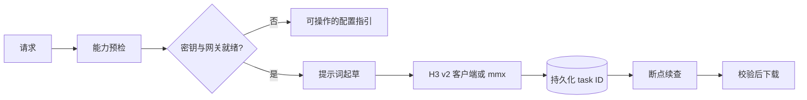

# MiniMax Design

## 插件市场导航

本插件所属分类：**AIGC 内容创作**。

| 分类 | 插件市场入口 | 用途 |
| --- | --- | --- |
| 全栈开发 | [Full Stack Plugins](https://github.com/partme-ai/full-stack-plugins) | 架构与 UI 设计、代码理解、质量检查、代码审查、流程治理与服务器运维 |
| AIGC 内容创作 | [Full AIGC Plugins](https://github.com/partme-ai/full-aigc-plugins) | 图像、视频、音频、音乐、3D 与多模态内容创作 |


> 在编码智能体里生成 MiniMax H3 视频、音乐、语音与图片：环境变量鉴权、首尾帧锚定，付费任务可续查且绝不重复提交。

[](https://github.com/full-aigc-plugins/minimax-design-plugin/releases)
[](#安装)
[](#技能)
[](LICENSE)

[English](README.md) | [简体中文](README.zh-CN.md) · [安装](#安装) · [快速开始](#快速开始) · [技能](#技能) · [故障排查](#故障排查)

## 项目定位

`minimax-design` 让编码智能体直接驱动 MiniMax 生成能力。它把一句需求变成 H3 视频（`t2v`、`i2v`、首尾帧 `FL2VA`、参考图）、音乐、语音、图片或文本，执行路径可以是确定性 Python 客户端，也可以是 vendor 的 `mmx` 工具箱；付费异步任务会被当作持久记录，而不是发出去就不管的调用。

默认创作路径是白模预演锚定：先在 Blender 中渲染每个镜头的首帧与尾帧，再让 H3 补出两帧之间的运动。提示词用 vendor 的 `h3-prompt-writing` 结构起草。

| 项目 | 值 |
| --- | --- |
| 插件 ID | `minimax-design` |
| 版本 | `0.5.1+codex.20261018` |
| 成熟度 | 已打包发布；本仓库没有保存真实供应商验收记录 |
| 运行环境 | Python 3（仅标准库）；`mmx` CLI 可选 |
| MCP 服务器 | 无；可执行客户端是 `scripts/minimax_video.py` |

## 安装

### 前置条件

- `PATH` 上有 Python 3，供 `scripts/minimax_video.py` 使用。
- MiniMax API Key，来自 [platform.minimax.cn](https://platform.minimax.cn)（国内）或 [platform.minimax.io](https://platform.minimax.io)（国际）。网关区域必须与密钥一致。
- 可选：`mmx` CLI 用于工具箱生成，安装方式 `npm install -g mmx-cli`，再用 `mmx auth login --api-key` 登录。
- 可选：需要 FL2VA 锚定时，准备配套 `blender-previs` 技能产出的白模首尾帧。

### 从插件市场安装

```bash
codex plugin marketplace add partme-ai/full-aigc-plugins
codex plugin add minimax-design@full-aigc-plugins
```

### 从仓库内置市场安装

```bash
codex plugin marketplace add full-aigc-plugins/minimax-design-plugin --ref v0.5.1
codex plugin add minimax-design@partme-ai-minimax-design
```

重启宿主并新建任务。ZCode 通过 `.zcode-plugin/plugin.json` 加载插件，并自动发现一次 `hooks/hooks.json`；Kimi 通过 `kimi.plugin.json` 加载其声明的钩子。

### 配置密钥

客户端按以下顺序解析密钥：进程环境变量、项目 `.env`、插件 `.env`、用户凭据文件。不想改 shell 配置时可直接持久化：

```bash
python3 scripts/minimax_video.py auth --api-key sk-...
python3 scripts/minimax_video.py check
```

`auth` 写入 `~/.minimax-design/credentials.json`，权限 `600`（可用 `MINIMAX_CONFIG_DIR` 改目录）。`check` 报告密钥来源、网关、模型与 `mmx` 状态；只显示末四位，绝不回显完整密钥。

## 快速开始

```bash
# 能力预检：鉴权链、网关、模型、mmx 状态
python3 scripts/minimax_video.py check

# 文生视频；T2VA 必须给 ratio
python3 scripts/minimax_video.py generate --prompt "..." --ratio 16:9 --out shot-01.mp4

# 用白模首尾帧做 FL2VA 锚定
python3 scripts/minimax_video.py generate --first-frame first.png --last-frame last.png \
  --prompt "两帧之间的连续运动" --out shot-01.mp4

# 轮询超时不是失败：续查同一个付费任务
python3 scripts/minimax_video.py query --task-id <task-id>
```

`generate` 接收 `--duration` 与 `--resolution`。模型限制：`MiniMax-H3` 支持 480P/768P/2K 与 4–15 秒；`MiniMax-H3-Max` 支持 480P/768P 与 5–15 秒。`list` 与 `cancel` 操作已有任务，客户端不会自动重新提交付费任务。

## 可完成的工作

| 工作流 | 内置路径 | 可验证输出 |
| --- | --- | --- |
| 文生视频 | `minimax-video-generation`、`generate --ratio` | 下载的 MP4 与持久 task ID |
| 图生视频 | `generate --first-frame` | 以给定首帧为锚的 MP4 |
| 首尾帧镜头 | `generate --first-frame --last-frame` | 在两帧预演之间插值的 MP4 |
| 主体一致的参考图 | `generate --reference-image` | 延续参考主体身份的 MP4 |
| 从简报做风格短片 | 八个风格生成器技能之一 | 镜头计划、提示词、生成片段与装配指引 |
| 音乐、语音与图片 | `mmx` 工具箱或 `minimax-music-gen` | 写入指定目录的音频、图片或文本产物 |

## 技能

| 技能 | 作用 |
| --- | --- |
| `minimax-design-use` | 先跑能力预检，再路由请求 |
| `minimax-video-generation` | H3 v2 工作流：`t2v`、`i2v`、`FL2VA`、参考图 |
| `minimax-multimodal-toolkit` | `mmx` 的文本、图片、视频、语音、音乐与搜索 |
| `minimax-music-gen` | 歌曲、器乐与背景音乐生成 |
| `minimax-music-playlist` | 听感画像与歌单生成 |
| `h3-prompt-writing` | T2VA、I2VA、FL2VA、L2VA、Ref2VA 提示词结构 |
| `3d-animation-short-generator` | 端到端风格化 3D 动画短片 |
| `brand-promo-video-generator` | 品牌与产品宣传短片 |
| `co-op-game-intro-generator` | 双人合作游戏菜单或开场动画 |
| `handdrawn-live-video-generator` | 手绘发光动画与实拍融合的 15 秒短片 |
| `minimalist-product-ad-generator` | 极简电商产品广告 |
| `music-video-subtitle-generator` | 歌词文字排版与 MV 镜头计划 |
| `paper-collage-explainer-generator` | 半调纸拼贴科普解说 |
| `papercraft-stop-motion-explainer` | 分层纸艺定格解说 |

`minimax-design-use` 与 `minimax-video-generation` 为插件自有。其余十二个逐字 vendor 自 `minimax-skills v1.1.1`，由 `skills.lock.json` 按技能固定 SHA-256；两类副本都不要就地修改。

## 斜杠命令

| 命令 | 作用 |
| --- | --- |
| `/minimax-check` | 预检鉴权链、网关、模型与 `mmx` 状态 |
| `/minimax-setup` | 跨平台密钥配置指引与 `auth` 持久化 |
| `/minimax-video` | 通用 H3 视频请求：`t2v`、`i2v` 或 `FL2VA` |
| `/minimax-t2v` | 文生视频，必须提供画幅比例 |
| `/minimax-i2v` | 以单张首帧为锚的图生视频 |
| `/minimax-fl2va` | 首尾帧锚定，两帧都必须提供 |
| `/minimax-ref2v` | 参考图视频生成 |
| `/minimax-episode` | 固定模式整集流水线：镜头表 → 逐镜生成 → 实测切点 |
| `/minimax-image` | 文生图，支持主体参考与批量 |
| `/minimax-speech` | 经 `mmx` 工具箱做语音合成 |
| `/minimax-music` | 经 MiniMax 音乐 API 生成歌曲或 BGM |

## 配置

| 设置 | 所在位置 | 说明 |
| --- | --- | --- |
| API Key | `MINIMAX_API_KEY` | 必填；可来自环境变量、`.env` 或用户凭据文件 |
| 网关 | `MINIMAX_API_HOST` | 默认 `https://api.minimax.cn`；国际账号用 `https://api.minimax.io` |
| 模型 | `MINIMAX_MODEL` | 默认 `MiniMax-H3`；极速档用 `MiniMax-H3-Max` |
| 凭据目录 | `MINIMAX_CONFIG_DIR` | 默认 `~/.minimax-design`，文件权限 `600` |
| `mmx` 凭据 | `~/.mmx/credentials.json` | 由 `mmx auth login` 管理，不归本插件所有 |

真实 Token 不得出现在 README、提示词、日志或测试夹具中。客户端只打印密钥来源与末四位；`check` 是建议性检查，退出码为 `0`，不阻塞会话。

## 架构与安全



| 组件 | 负责 | 不负责 |
| --- | --- | --- |
| `scripts/minimax_video.py` | 鉴权解析、v2 提交/轮询/下载、`auth` 持久化 | 提示词质量 |
| `scripts/vendor/skill_vendor.py` | 不可变技能导入与摘要校验 | 技能内容 |
| `hooks/env_check.py` | 会话启动时的建议性环境检查 | 阻塞会话 |
| `skills/`（14 个） | 路由、提示词结构与生产工作流 | 运行时强制 |

插件只访问你配置的 MiniMax 端点，不中转流量，也不把流量转给作者。凭据只留在宿主的敏感配置、环境变量或本机凭据文件中，不写入产物。网络请求有超时；付费 task ID 会在轮询前持久化，因此超时是「续查」而不是重复扣费。

## 故障排查

| 现象 | 优先检查 | 处理方式 |
| --- | --- | --- |
| `check` 报告没有密钥 | 解析链 | 导出 `MINIMAX_API_KEY`、写入项目 `.env`，或执行 `auth --api-key` |
| 鉴权失败 | 网关与密钥区域 | 让 `MINIMAX_API_HOST` 与账号区域一致 |
| 视频任务超时 | 已持久化的 task ID | 查询同一任务；绝不重新提交付费作业 |
| `mmx` 命令不存在 | CLI 是否安装 | `npm install -g mmx-cli`，再 `mmx auth login --api-key` |
| 模型或时长被拒绝 | 模型矩阵 | H3 支持 480P/768P/2K 与 4–15 秒；H3-Max 支持 480P/768P 与 5–15 秒 |
| FL2VA 没有锚点帧 | 预演输入 | 先渲染首尾帧，或改用 `/minimax-i2v` |

## 升级

```bash
codex plugin marketplace upgrade partme-ai-minimax-design
codex plugin add minimax-design@partme-ai-minimax-design
```

## 贡献与支持

功能问题请提交到 <https://github.com/full-aigc-plugins/minimax-design-plugin/issues>。提交变更前，请说明你验证过的宿主、是否改动凭据解析链或模型矩阵，并附上受影响的检查。

## 许可证

Apache-2.0，见 [LICENSE](LICENSE)、[NOTICE](NOTICE) 与 [THIRD_PARTY_NOTICES.md](THIRD_PARTY_NOTICES.md)。vendor 技能保留各自许可。
